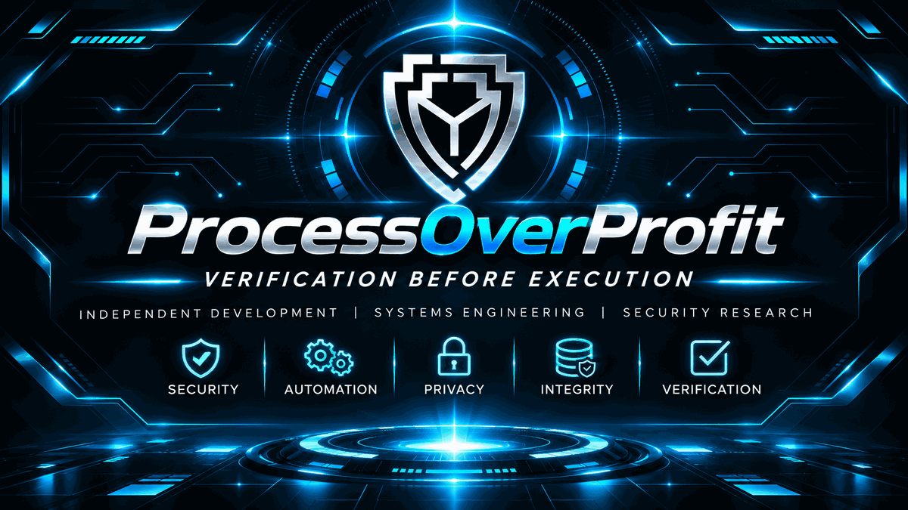

# ProcessOverProfit | Engineering HQ

**Independent Software Engineering · Linux · Security Research**

### Verification Before Execution

Welcome to ProcessOverProfit, my public engineering portfolio. I'm independently developing private, local-first software projects while learning through hands-on engineering, AI-assisted development and review, and constructive community feedback.

The public repositories explain the projects, their design goals, development status and review questions. They do not distribute the private applications or ask anyone to trust unverified software with their money or systems.

**Explore:** [Projects](#projects) · [Technical documentation](#technical-documentation) · [Roadmap](docs/ROADMAP.md) · [Community](#join-the-processoverprofit-community) · [Engineering philosophy](#engineering-philosophy) · [Privacy](#privacy-and-source-availability)

---

## Projects

| Project | Focus | Public status | Repository |
| --- | --- | --- | --- |
| **T-Bot / Investment BOT** | Local-first Solana trading architecture and deterministic risk controls | Active private development and staged security qualification; no live-money authorisation | [T-Bot](https://github.com/processoverprofit-sys/T-Bot) |
| **BrainBot / BrainBot PC** | Local-first Ubuntu desktop application and user-facing control environment | Desktop development line recorded as completed and frozen; source remains private | [BrainBot](https://github.com/processoverprofit-sys/BrainBot) |

### T-Bot / Investment BOT

T-Bot is a privately developed, single-user automated trading system focused on Solana. Originally conceived as a personal trading bot, the project has evolved into a research and engineering effort covering market discovery, token-risk assessment, deterministic risk controls and governed execution.

**Engineering focus:** fail-closed validation, explicit authorisation, signing separation, bounded risk, software integrity and evidence-led verification. These are design objectives, not assertions of independently verified implementation or production readiness.

T-Bot is not a qualified operational trading system or public product. Live-money execution is not currently authorised, and no profitability or trading performance is claimed.

[Explore T-Bot and its technical documentation](https://github.com/processoverprofit-sys/T-Bot)

### BrainBot / BrainBot PC

BrainBot is a separate local-first Ubuntu desktop application and user-facing control environment, intended to provide structured interaction with approved local resources while maintaining access, authentication and privilege boundaries.

**Design focus:** local-first interaction, controlled permissions, separation of interface and backend responsibilities, and user control.

The BrainBot PC 3.5.0–3.5.3 development line has been recorded as complete and frozen. The earlier Android direction has been discontinued. This historical milestone does not establish general production readiness, an independent security audit or a public product release.

[Explore BrainBot](https://github.com/processoverprofit-sys/BrainBot)

## Technical documentation

Following constructive Reddit feedback, T-Bot's Level 2 public technical documentation has been published. It gives developers a starting point for reviewing design principles and proposing improvements without disclosing the private implementation.

| Document | What you can review |
| --- | --- |
| [Architecture](https://github.com/processoverprofit-sys/T-Bot/blob/main/docs/ARCHITECTURE.md) | Conceptual components and trust boundaries |
| [Risk principles](https://github.com/processoverprofit-sys/T-Bot/blob/main/docs/RISK_PRINCIPLES.md) | Intended public risk-control requirements |
| [Threat model](https://github.com/processoverprofit-sys/T-Bot/blob/main/docs/THREAT_MODEL.md) | Preliminary threats, control objectives and residual uncertainty |
| [Testing](https://github.com/processoverprofit-sys/T-Bot/blob/main/docs/TESTING.md) | Proposed methodology and fictional, unexecuted example cases |
| [Development status](https://github.com/processoverprofit-sys/T-Bot/blob/main/docs/DEVELOPMENT_STATUS.md) | Qualification status, limitations and review provenance |
| [Community feedback](https://github.com/processoverprofit-sys/T-Bot/blob/main/docs/COMMUNITY_FEEDBACK.md) | Feedback received, responses and remaining questions |

For an overview of public milestones and planned documentation work, see the [public roadmap](docs/ROADMAP.md).

## How the projects relate

BrainBot provides a local user-facing software environment. T-Bot provides specialised trading discovery, analysis, risk qualification, execution control and evidence architecture. They remain independent projects with distinct responsibilities and security boundaries.

Any future integration must preserve those boundaries. A user interface must never bypass authorisation, signing or risk controls. Neither the public repositories nor community channels provide a route to private systems.

## Join the ProcessOverProfit community

I've created a dedicated ProcessOverProfit Discord community for developers, Linux enthusiasts, project followers and people who want to learn together. GitHub repository notifications are connected to Discord.

I welcome constructive discussion about architecture, Python, Linux, Solana, desktop software, risk requirements, testing and technical documentation. You do not need to be an expert to express interest.

**How to get involved:** read the [community guide](docs/COMMUNITY.md#requesting-discord-access) for invitation-request guidance. If you found ProcessOverProfit through Reddit or another community discussion, you can ask for an invitation there where the community rules permit. Discord access is managed by the maintainer; a public invitation link is not currently listed.

Joining the community does not grant access to private source code, operational systems, signing authority or funds.

## Engineering philosophy

- **Security before convenience** and **verification before execution**
- **Minimum necessary authority** and controlled failure handling
- **Deterministic behaviour** where required
- **Reproducibility, integrity and traceable evidence**
- **Controlled deployment, rollback and recovery**
- **Local ownership, privacy and operational control**

Development is owner-led and AI-assisted. AI can support research, coding, analysis and review, but does not substitute for independent human assurance or professional security certification.

## Technical interests

Python · Linux · Solana · Security Engineering · Desktop Applications · Wallet Security · Cryptographic Verification · Software Integrity · Reproducible Builds · Automation · Systems Architecture

## Feedback and security reporting

Non-sensitive documentation corrections may be proposed through public pull requests at the maintainer's discretion. Read [CONTRIBUTING.md](CONTRIBUTING.md) first. Public Issues, Discussions, Wiki and Projects are not currently offered as community channels.

For security concerns about this public repository, use the confidential reporting route described in [SECURITY.md](SECURITY.md). Do not post vulnerabilities, sensitive evidence or private information publicly. No permission to access or test private systems is granted.

## Privacy and source availability

T-Bot and BrainBot are privately developed and are **not currently distributed as public software products**. These public repositories are documentation-focused, not releases of their private applications.

Production source, private keys, wallet addresses, signing material, API credentials, operational configuration, sensitive environment details, private test evidence and governance records are **not publicly available**. Selected non-sensitive research or engineering findings may be published separately following review.

This profile uses a project identity rather than a personal identity. No financial returns, independent security certification or production readiness are implied. Nothing in this portfolio is an investment service or an invitation to deposit funds or connect a wallet.

---

**Developed on Linux.**

**ProcessOverProfit — Building systems that prioritise control, integrity and evidence over assumptions.**

*Independent projects. No affiliation with or endorsement by OpenAI, Solana or other third-party organisations is implied.*
