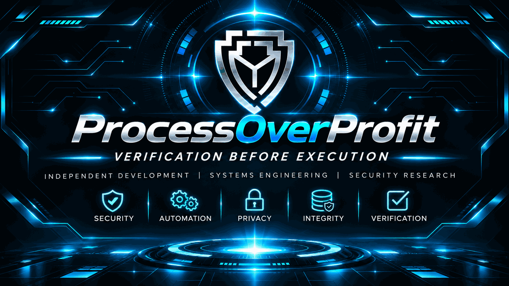

# ProcessOverProfit | Engineering HQ

**Independent Software Engineering · Linux · Security Research**

### Verification Before Execution

A public engineering portfolio documenting security-first software development, local-first architecture, deterministic systems and independently maintained projects.

**Explore:** [Projects](#projects) · [Project boundaries](#how-the-projects-relate) · [Engineering philosophy](#engineering-philosophy) · [Technical interests](#technical-interests) · [Privacy](#privacy-and-source-availability)

---

## Projects

| Project | Focus | Public status | Repository |
| --- | --- | --- | --- |
| **T-Bot / Investment BOT** | Local-first Solana trading architecture and deterministic risk controls | Active private development and staged security qualification; no live-money authorization | [T-Bot](https://github.com/processoverprofit-sys/T-Bot) |
| **BrainBot / BrainBot PC** | Local-first Ubuntu desktop application and user-facing control environment | Desktop development line recorded as completed and frozen; source remains private | [BrainBot](https://github.com/processoverprofit-sys/BrainBot) |

### T-Bot / Investment BOT

T-Bot is a privately developed, single-user automated trading system focused on Solana and newly launched tokens. Originally designed as a personal trading bot, the project has evolved into a hardened trading and execution architecture combining market discovery, token-risk screening, risk controls and governed transaction execution.

**Engineering focus:** deterministic decisions rather than LLM-controlled trading; fail-closed validation; signing separation; bounded authorization; dedicated wallet and exposure controls; token-risk qualification; software integrity; Linux isolation; controlled updates and recovery; and evidence-driven engineering.

Production readiness and funded trading are **not claimed**. Live execution requires separate readiness qualification and explicit authorization.

[Read the public T-Bot overview](https://github.com/processoverprofit-sys/T-Bot)

### BrainBot / BrainBot PC

BrainBot is a separate local-first Ubuntu desktop application and user-facing control environment, intended to provide structured interaction with approved local resources while maintaining access, authentication and privilege boundaries.

**Design focus:** local-first interaction; authenticated access to approved resources; separation of interface and backend responsibilities; restricted source-tree visibility; controlled access to operational resources; and no unrestricted wallet or signing authority.

The BrainBot PC 3.5.0–3.5.3 development line has been recorded as complete and frozen. The earlier Android direction has been discontinued. BrainBot is **not** an autonomous trading engine and does not replace T-Bot.

[Read the public BrainBot overview](https://github.com/processoverprofit-sys/BrainBot)

## How the projects relate

BrainBot provides a local user-facing software environment. T-Bot provides specialised trading discovery, analysis, risk qualification, execution control and evidence architecture. They remain independent projects with distinct responsibilities and security boundaries.

Any future integration must preserve those boundaries. A user interface must never bypass authorization, signing or risk controls.

## Engineering philosophy

- **Security before convenience** and **verification before execution**
- **Minimum necessary authority** and controlled failure handling
- **Deterministic behaviour** where required
- **Reproducibility, integrity and traceable evidence**
- **Controlled deployment, rollback and recovery**
- **Local ownership, privacy and operational control**

## Technical interests

Python · Linux · Solana · Security Engineering · Desktop Applications · Wallet Security · Cryptographic Verification · Software Integrity · Reproducible Builds · Automation · Systems Architecture

## Feedback and security reporting

Non-sensitive documentation corrections may be proposed through public pull requests. Public Issues, Wiki and Projects are disabled. For concerns about this public repository, use the confidential reporting route described in [SECURITY.md](SECURITY.md). This does not grant access to private software or infrastructure.

## Privacy and source availability

T-Bot and BrainBot are privately developed and are **not currently distributed as public software products**. These public repositories are documentation-focused, not releases of their private applications.

Production source, private keys, signing material, credentials, operational configuration, sensitive environment details, private test evidence and governance records are **not publicly available**. Selected non-sensitive research and engineering findings may be published separately in the future.

This profile uses a project identity rather than a personal identity. No financial returns, independent security certification or production readiness are implied.

---

**ProcessOverProfit** — Building systems that prioritise control, integrity and evidence over assumptions.

*Independent projects. No affiliation with or endorsement by OpenAI, Solana or other third-party organisations is implied.*
